

  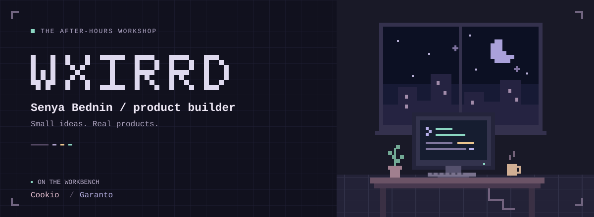

  <strong>Hey, I'm Senya.</strong> I build products for everyday problems. 
  Working across web, mobile and AI — from an idea to something you can use.

  <a href="https://github.com/wxirrd?tab=repositories">Explore my repos ↗</a>
  &nbsp;·&nbsp;
  <a href="https://github.com/wxirrd">@wxirrd</a>

 

### Currently on my workbench

<table>
  <tr>
    <td width="50%" valign="top">
      <h3>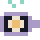 Cookio</h3>
      
<strong>A little AI for the everyday “what's for dinner?”</strong>

      
An AI assistant that generates recipes from the ingredients you already have.

      
<code>AI</code> <code>Food</code> <code>Everyday tools</code>

      
Coming soon

    </td>
    <td width="50%" valign="top">
      <h3> Garanto</h3>
      
<strong>Connecting the people behind a car import.</strong>

      
A platform connecting car buyers with importers and logistics partners.

      
<code>Platform</code> <code>Automotive</code> <code>Logistics</code>

      
<a href="https://grnto.ru"><strong>Explore Garanto ↗</strong></a>

    </td>
  </tr>
</table>

 

### My toolkit

#### Web

  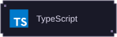
  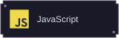
  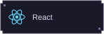
  
  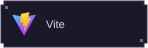
  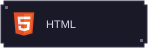
  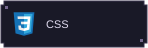
  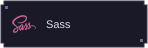

#### Mobile

  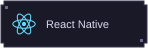
  

#### Backend

  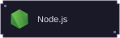
  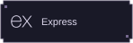
  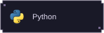
  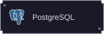

#### Tools

  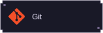
  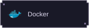

 

---

  <strong>Have an idea? Let's build it.</strong> 
  <a href="https://t.me/wxirrd">Telegram · @wxirrd ↗</a>

<!-- Enable when the personal website is ready:

<a href="https://bednin.ru">bednin.ru ↗</a>

-->

Senya Bednin &nbsp; / &nbsp; wxirrd &nbsp; / &nbsp; Products, AI &amp; startups

